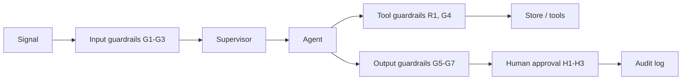

# ThreadLine guardrails, risk controls and human approval

Based on Module 6 (Guardrails, Risk Controls and Human Approval).

- **Guardrail**: is this input or output acceptable?
- **Risk control**: is this agent allowed to do this at all?
- **Human approval**: must a person say yes first?

Human approval never overrides a guardrail or a risk control.



## Checks

| ID | Where it runs | What it does | Module 6 risk | Code | Status |
|---|---|---|---|---|---|
| G1 | Input, before the Correlator | Signal must match the schema (fields, ID pattern, dated timestamp); otherwise rejected | Input validation | `system.py` `validate_signal` | Built |
| G2 | Input, and again before the Action Drafter | Flags instructions hidden in signal content ("ignore previous instructions", "system override", ...). The text stays as quoted evidence, and no action is drafted for any thread that contains a flagged signal | Prompt injection | `guardrails.py` `check_injection`, `guard_signal` | Built |
| G3 | Input, before storage or any model call | Replaces secrets (API keys, tokens, passwords) with `[REDACTED]` | Sensitive information disclosure | `guardrails.py` `redact_secrets` | Built |
| R1 | Every tool call | Permission table: only the Correlator may call `find_candidate_threads` and `commit_signal`; the other agents have no tools. Any other call raises `ToolDenied` and the tool never runs | Excessive agency, least privilege | `guardrails.py` `TOOL_PERMISSIONS`, `check_tool_call` | Built |
| G4 | Before a tool runs | Arguments checked against the tool's JSON schema: required fields, types, no extra fields (Lab 3 feedback 2.2) | Tool guardrail | `guardrails.py` `TOOL_SCHEMAS`, `check_tool_call` | Built |
| R2 | Whole system | No agent can execute anything; even an approved proposal stays `executed: false` | Excessive agency | No executor exists | Built |
| G5 | Output, Narrator | Grounding Validator: every quote exact, every cited ID in the thread; one revision, then escalation | Misinformation | `system.py` `GroundingValidator` | Built |
| G6 | Output, Action Drafter | Only `inspect_evidence` or `request_service`, real citations, approval flag true | Improper output handling | `system.py` `ActionDrafter` | Built (runbook gate for mitigations is designed, not yet merged) |
| G7 | Output, after the Validator approves | Flags cause words ("caused", "root cause", "due to") in the summary as a warning for the reviewer | Misinformation | `guardrails.py` `check_cause_words` | Built |
| H1 | After the Drafter | Every proposal is saved with status `pending`; the run stops at `awaiting_approval` | Human approval (approval gated) | `approval.py` `ApprovalQueue.submit` | Built |
| H2 | Human | A named person approves or rejects with a reason, once. A proposal flagged by G2 or missing the G6 flag cannot be approved | Human approval | `approval.py` `ApprovalQueue.decide` | Built |
| H3 | After every submit and decision | One line appended to `audit_log.jsonl` (time, proposal, event, who, reason) | Accountability | `approval.py` `_audit` | Built |

## Try it

```bash
python3 -m unittest lab4.test_system lab4.test_concordia lab4.test_guardrails   # 33 tests
python3 -m lab4.run --mode dynamic --queue lab4/approvals
python3 -m lab4.approval list
python3 -m lab4.approval approve APR-001 --by "Your name" --reason "Why you agree"
```

Evidence: `lab4/test_guardrails.py` (15 tests, one or more per row), `lab4/traces/dynamic.json` and `static.json` (guardrail events in every run), `lab4/traces/approval_demo/` (one approval, one rejection, full audit log).

## Autonomy level (Module 6, slide 13)

ThreadLine is **approval gated**: agents prepare, a human approves. Nothing reaches a production system.