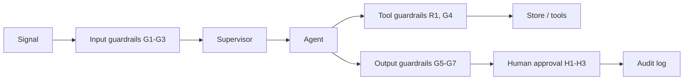

# ThreadLine guardrails, risk controls and human approval

Based on Module 6 (Guardrails, Risk Controls and Human Approval).

- **Guardrail**: is this input or output acceptable?
- **Risk control**: is this agent allowed to do this at all?
- **Human approval**: must a person say yes first?

Human approval never overrides a guardrail or a risk control.

## Checks

| ID | Where it runs | What it does | Module 6 risk | Status |
|---|---|---|---|---|
| G1 | Input, before the Correlator | Signal must match the schema (fields, ID pattern, dated timestamp); otherwise rejected | Input validation | Exists (`validate_signal`) |
| G2 | Input, before any agent | Detects instructions hidden in signal content ("ignore previous instructions", "system override", ...). Sets `injection_detected: true`; the text stays a quote and is never followed | Prompt injection | To build (step 3) |
| G3 | Input, before any model call | Hides secrets found in content (API keys, tokens, passwords) as `[REDACTED]` | Sensitive information disclosure | To build (step 3) |
| R1 | Every tool call | Permission table: each agent may call only its own tools; any other call is refused and logged | Excessive agency, least privilege | To build (step 4) |
| G4 | Before a tool runs | Arguments checked against the tool's JSON schema (also fixes Lab 3 feedback 2.2 and 3.3) | Tool guardrail | Partly exists (guarded `commit`) |
| R2 | Whole system | No agent can execute anything; every action is `draft_only` | Excessive agency | Exists |
| G5 | Output, Narrator | Grounding Validator: every quote exact, every cited ID in the thread | Misinformation | Exists |
| G6 | Output, Action Drafter | Only allowed action kinds, real citations, approval flag true; rollback only if the runbook check passed | Improper output handling | Exists |
| G7 | Output, Narrator | Flags cause words ("caused", "root cause") in the summary, because the Narrator must not claim causes | Misinformation | To build (step 3) |
| H1 | After the Drafter | Every proposal is saved to an approval queue with status `pending`; the run stops at `awaiting_approval` | Human approval (approval gated) | To build (step 5) |
| H2 | Human | A person approves or rejects with their name and a reason; approval cannot skip G1 to G7 or R1 | Human approval | To build (step 5) |
| H3 | After a decision | Each decision is added to `audit_log.jsonl` (who, when, proposal, decision, reason) | Accountability | To build (step 5) |

## Autonomy level (Module 6, slide 13)

ThreadLine is **approval gated**: agents prepare, a human approves. Nothing reaches a production system.